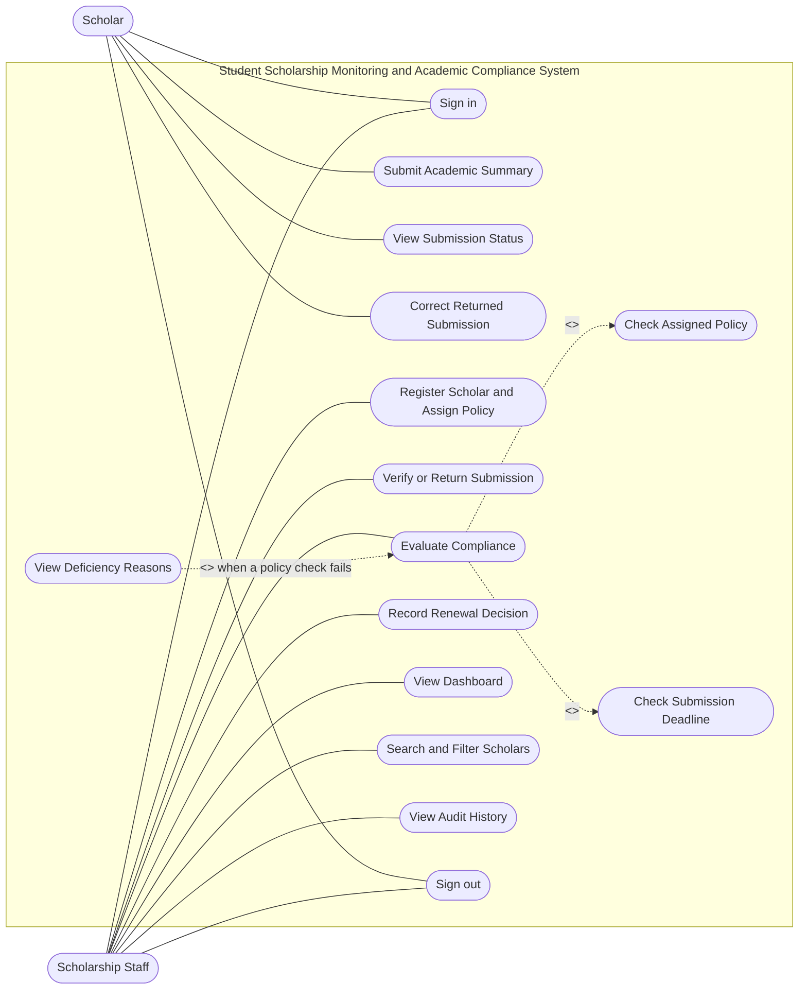

# UML Use Case Diagram and ERD

These diagrams describe the Student Scholarship Monitoring and Academic Compliance System. The two required actors are Scholar and Scholarship Staff.

## UML Use Case Diagram



**Relationship justification**
- Evaluate Compliance includes Check Assigned Policy because every evaluation must read the scholar's persisted scholarship thresholds.
- Evaluate Compliance includes Check Submission Deadline because every evaluation must compare the server-recorded submission time with the program deadline.
- View Deficiency Reasons extends Evaluate Compliance only when one or more policy checks fail.

## Entity Relationship Diagram

The database stores the compliance status and deficiency reasons on grade_submissions; it does not use a separate compliance-evaluations table.

```mermaid
erDiagram
  AUTH_USERS ||--|| PROFILES : has
  AUTH_USERS o|--o| SCHOLARS : login_for
  SCHOLARSHIP_PROGRAMS ||--o{ SCHOLARS : assigned_to
  SCHOLARS ||--o{ GRADE_SUBMISSIONS : submits
  GRADE_SUBMISSIONS ||--o| RENEWAL_DECISIONS : receives
  AUTH_USERS o|--o{ GRADE_SUBMISSIONS : verifies_or_evaluates
  AUTH_USERS o|--o{ RENEWAL_DECISIONS : decides
  AUTH_USERS o|--o{ AUDIT_LOGS : performs
  PROFILES {
    uuid id PK
    text full_name
    text role
  }
  SCHOLARSHIP_PROGRAMS {
    uuid id PK
    text program_name UK
    numeric required_gwa
    numeric max_gwa
    integer min_units
    integer max_failed
    integer max_incomplete
    integer max_dropped
    timestamptz deadline
    boolean active
  }
  SCHOLARS {
    uuid id PK
    uuid user_id FK
    text student_id UK
    text full_name
    text degree_program
    uuid scholarship_id FK
    text status
  }
  GRADE_SUBMISSIONS {
    uuid id PK
    uuid scholar_id FK
    text academic_year
    integer semester
    numeric gwa
    integer units_enrolled
    integer failed_subjects
    integer incomplete_subjects
    integer dropped_subjects
    text evidence_reference
    timestamptz submitted_at
    text submission_status
    text verification_reason
    text compliance_status
    text deficiency_reasons
  }
  RENEWAL_DECISIONS {
    uuid id PK
    uuid submission_id FK_UK
    text decision
    text reason
    uuid decided_by FK
    timestamptz decided_at
  }
  AUDIT_LOGS {
    bigint id PK
    uuid actor_id FK
    text action
    text entity_type
    uuid entity_id
    jsonb details
    timestamptz created_at
  }
```

## Relationship notes
- Each authenticated account has a profile and a role.
- A scholar login link is optional until a test account is linked to a scholar record.
- One scholarship program can be assigned to many scholars.
- Each scholar can submit one record per academic year and semester; a unique constraint blocks duplicate terms.
- Each submission stores the verification status, compliance result, and specific deficiency reasons.
- Each submission can have at most one current renewal decision; staff changes are recorded in audit history.
- Database policies restrict scholars to their own records and reserve verification, evaluation, and renewal actions for Scholarship Staff.
