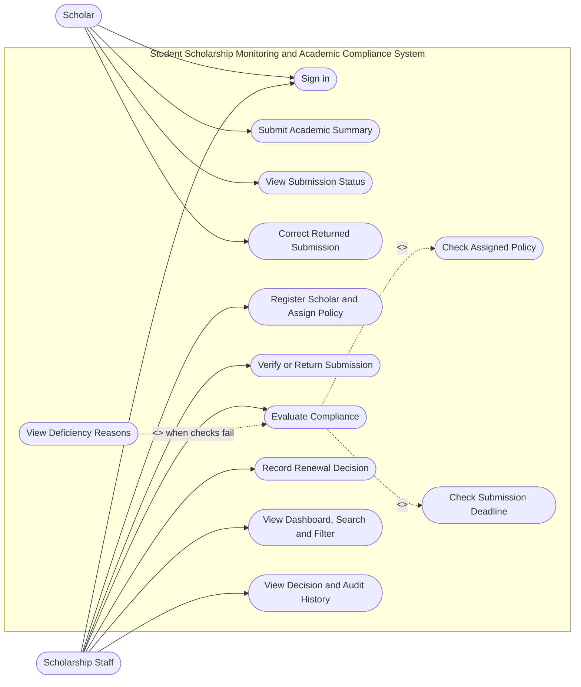
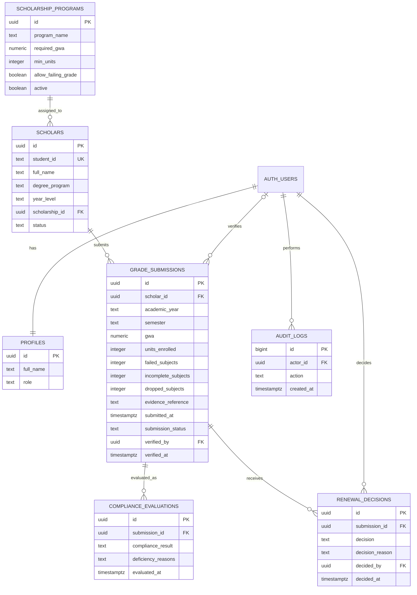

# UML Use Case Diagram and ERD

These diagrams represent the scope and core data model required by the examination. GitHub renders Mermaid diagrams in the Markdown preview.

## Use Case Diagram

## Entity Relationship Diagram

## Relationship notes
- Each authenticated account has a profile and role.
- A scholarship program can be assigned to many scholars.
- Each scholar can submit one record per academic year and semester; duplicate term submissions must be blocked.
- Each submission has verification status, compliance evaluation history, and renewal decision history.
- A submission can be Verified while its compliance result is With Deficiency and the scholarship award remains Active. These statuses are separate.
- Backend/database access rules must restrict scholars to their own records and reserve verification, evaluation, and renewal actions for Scholarship Staff.
