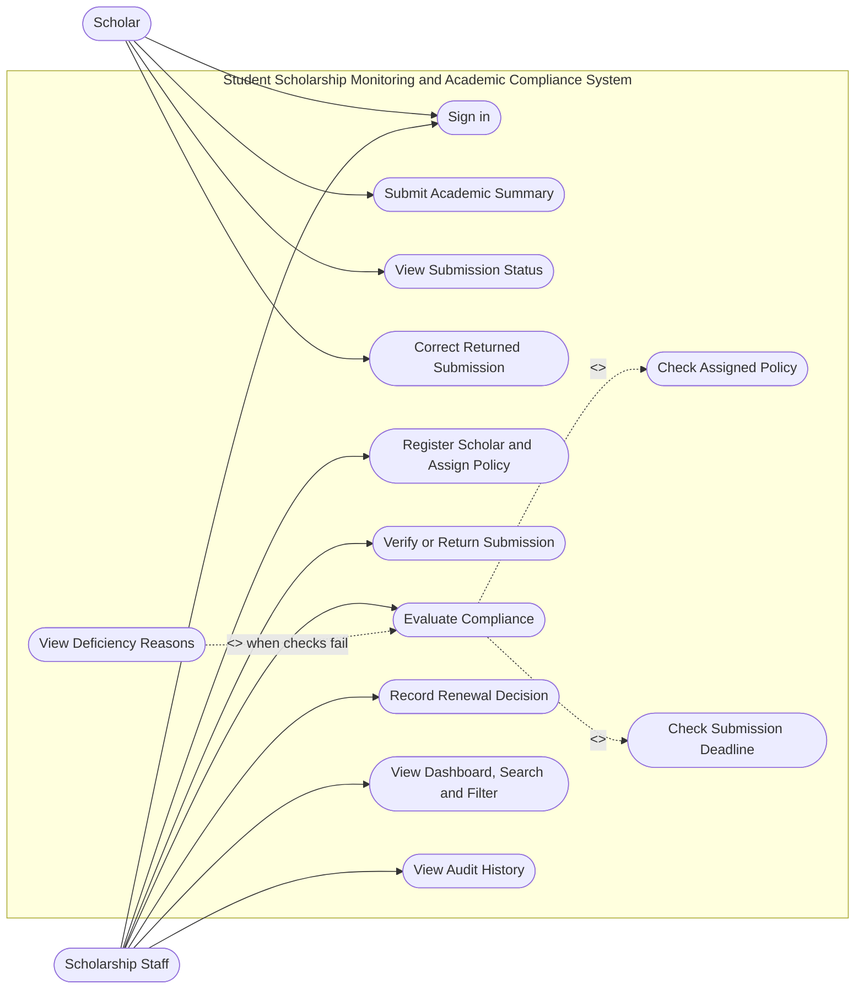

# UML Use Case Diagram and ERD

These diagrams represent the Student Scholarship Monitoring and Academic Compliance System. The Mermaid source can be viewed in GitHub's Markdown preview.

## Use Case Diagram



## Entity Relationship Diagram

The database stores the compliance status and deficiency reasons on `grade_submissions`; there is no separate compliance-evaluations table in this schema.

```mermaid
erDiagram
  AUTH_USERS ||--|| PROFILES : has
  AUTH_USERS o|--o| SCHOLARS : login_for
  SCHOLARSHIP_PROGRAMS ||--o{ SCHOLARS : assigned_to
  SCHOLARS ||--o{ GRADE_SUBMISSIONS : submits
  GRADE_SUBMISSIONS ||--o| RENEWAL_DECISIONS : receives
  AUTH_USERS o|--o{ GRADE_SUBMISSIONS : verifies_or_evaluates
  AUTH_USERS o|--o{ RENEWAL_DECISIONS : decides
  AUTH_USERS o|--o{ AUDIT_LOGS : performs
  PROFILES {
    uuid id PK
    text full_name
    text role
  }
  SCHOLARSHIP_PROGRAMS {
    uuid id PK
    text program_name UK
    numeric max_gwa
    integer min_units
    integer max_failed
    integer max_incomplete
    integer max_dropped
    timestamptz deadline
    boolean active
  }
  SCHOLARS {
    uuid id PK
    uuid user_id FK
    text student_id UK
    text full_name
    text degree_program
    uuid scholarship_id FK
    text status
  }
  GRADE_SUBMISSIONS {
    uuid id PK
    uuid scholar_id FK
    text academic_year
    integer semester
    numeric gwa
    integer units_enrolled
    integer failed_subjects
    integer incomplete_subjects
    integer dropped_subjects
    text evidence_reference
    timestamptz submitted_at
    text submission_status
    text verification_reason
    text compliance_status
    text deficiency_reasons
  }
  RENEWAL_DECISIONS {
    uuid id PK
    uuid submission_id FK_UK
    text decision
    text reason
    uuid decided_by FK
    timestamptz decided_at
  }
  AUDIT_LOGS {
    bigint id PK
    uuid actor_id FK
    text action
    text entity_type
    uuid entity_id
    jsonb details
    timestamptz created_at
  }
```

## Relationship notes
- Each authenticated account has a profile and a role.
- A scholar login link is optional until a test account is linked to a scholar record.
- A scholarship program can be assigned to many scholars.
- Each scholar can submit one record per academic year and semester; duplicate terms are blocked.
- Each submission stores verification status, compliance result, and deficiency reasons.
- Each submission can have at most one current renewal decision; the decision is upserted by the staff workflow.
- Database policies restrict scholars to their own records and reserve verification, evaluation, and renewal actions for Scholarship Staff.
